# Eclipse_Git

- [Java 프로젝트와 클래스](#java-프로젝트와-클래스)
- [인코딩 설정](#인코딩-설정)
- [Git 저장소 만들기](#git-저장소-만들기)
- [Git 뷰 열기와 커밋](#git-뷰-열기와-커밋)
- [브랜치 만들기](#브랜치-만들기)
- [브랜치 병합](#브랜치-병합)
- [GitHub 원격 저장소 연결](#github-원격-저장소-연결)
- [프로젝트 가져오기](#프로젝트-가져오기)
- [충돌 해결](#충돌-해결)
- [협업 연습](#협업-연습)

 

---

### Java 프로젝트와 클래스

> Eclipse에서 `File, New, Java Project`로 프로젝트를 만든다. 예제의 프로젝트 이름은 `fullstack_support`이고 JRE는 `JavaSE-21`, 소스와 클래스 파일은 폴더를 나누는 기본 설정(`Create separate folders for sources and class files`)을 쓴다. `src`에서 오른쪽 마우스, `New, Package`로 패키지(`Ch00`)를 만들고 `New, Class`로 클래스(`C01Master`)를 만든다.

 

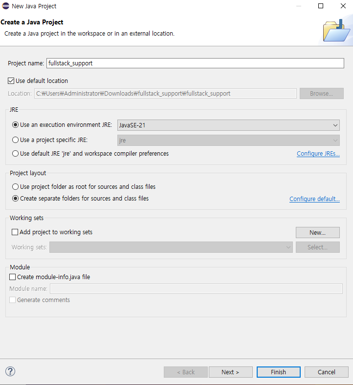

 

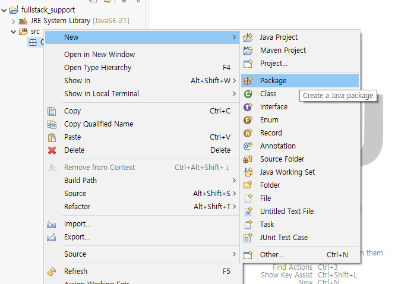

 

패키지 이름이 이미 있으면 `Package already exists.` 오류가 나온다. 클래스를 만들 때는 `public static void main(String[] args)`에 체크해 실행 메서드를 함께 만든다. 패키지 이름을 대문자로 시작하면 소문자로 시작하라는 경고가 나오지만 만들 수 있다.

 

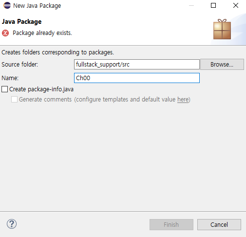

 

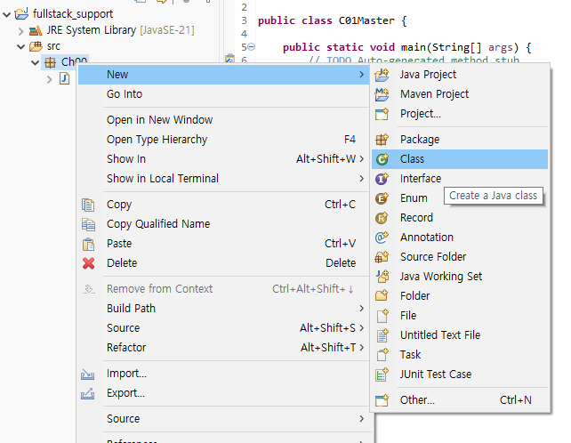

 

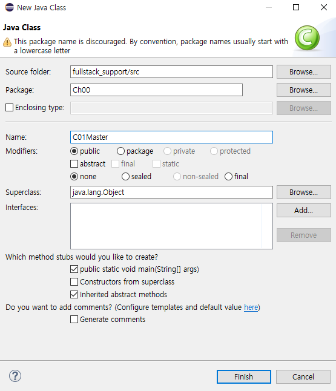

 

---

### 인코딩 설정

> 한글이 깨지지 않도록 문자 인코딩을 UTF-8로 맞춘다. `Window, Preferences`의 `General, Workspace`에서 `Text file encoding`을 기본값(`MS949`)에서 `Other: UTF-8`로 바꾸고 `Apply and Close`를 누른다. 과제 제출 때는 UTF-8로 확인했다는 스크린샷이 필요하다.

 

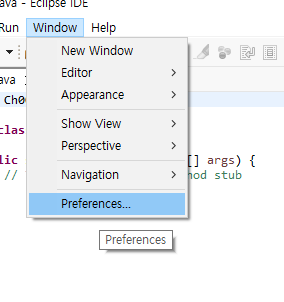

 

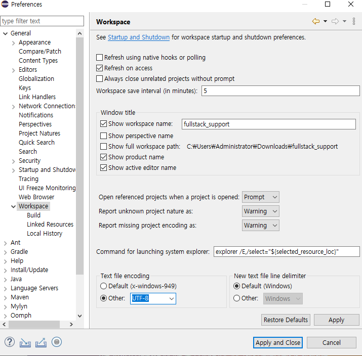

 

설정 후 `C01Master`에 `System.out.println("V0.0 Master(조장: 홍길동)");`를 작성한다.

 

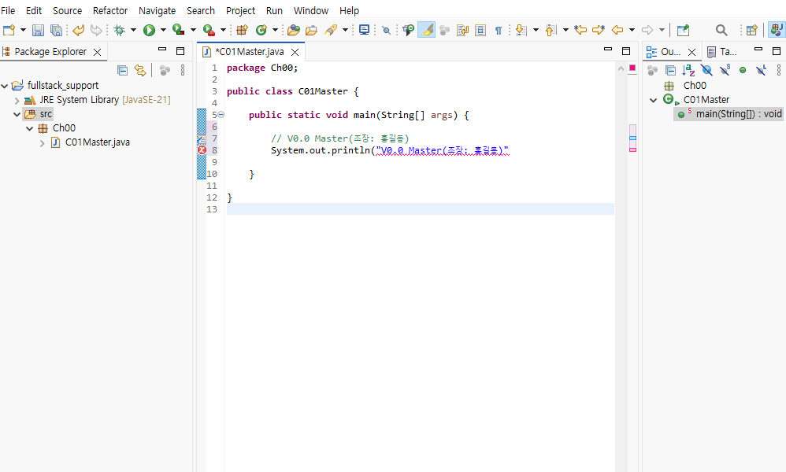

 

---

### Git 저장소 만들기

> 프로젝트에서 오른쪽 마우스, `Team, Share Project...`를 선택하고 `Use or create repository in parent folder of project`를 체크한 뒤 `Create Repository`를 누르면 프로젝트 폴더에 `.git`이 만들어진다. `Repository` 열에 `.git`이 나타나면 `Finish`를 누른다. Eclipse 작업 공간 안에 저장소를 만드는 것은 권장하지 않는다는 경고가 나온다.

 

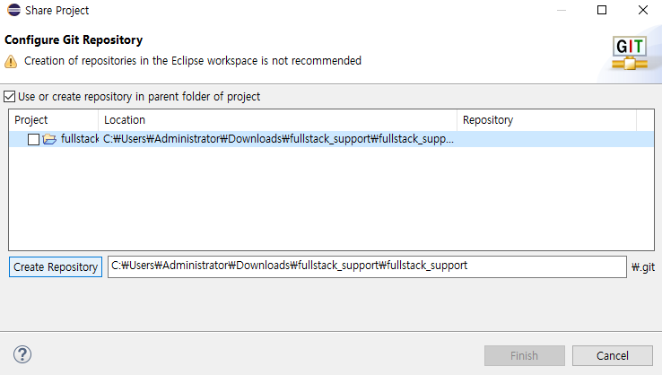

 

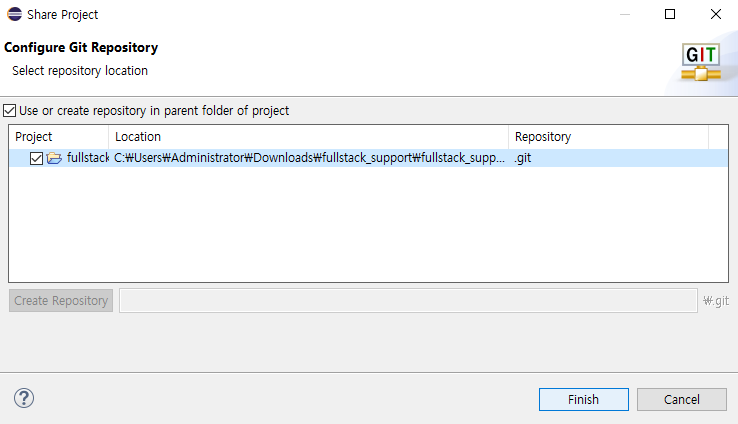

 

Share 후에는 프로젝트 이름 옆에 `[저장소 이름 master]`가 표시된다.

 

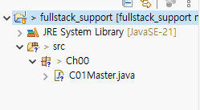

 

---

### Git 뷰 열기와 커밋

> `Window, Show View, Other...`에서 `Git` 아래의 `Git Repositories`(저장소와 브랜치 목록)와 `Git Staging`(변경 파일과 커밋)을 연다. `History`도 같은 방법으로 열 수 있다.

 

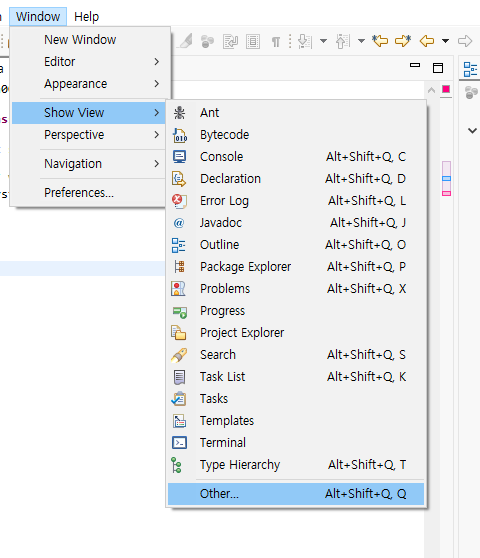

 

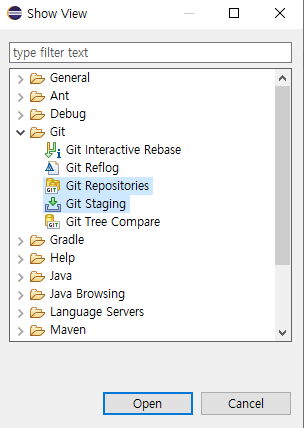

 

`Git Staging`은 변경된 파일을 `Unstaged Changes`와 `Staged Changes`로 보여준다. 변경 파일(`.classpath`, `.gitignore`, `.project`, `C01Master.java` 등)을 Staged로 옮기고 `Commit Message`를 쓴 뒤 `Commit`을 누른다. 예제의 커밋 메시지는 `V0.0 Master(조장: 홍길동)`이다.

 

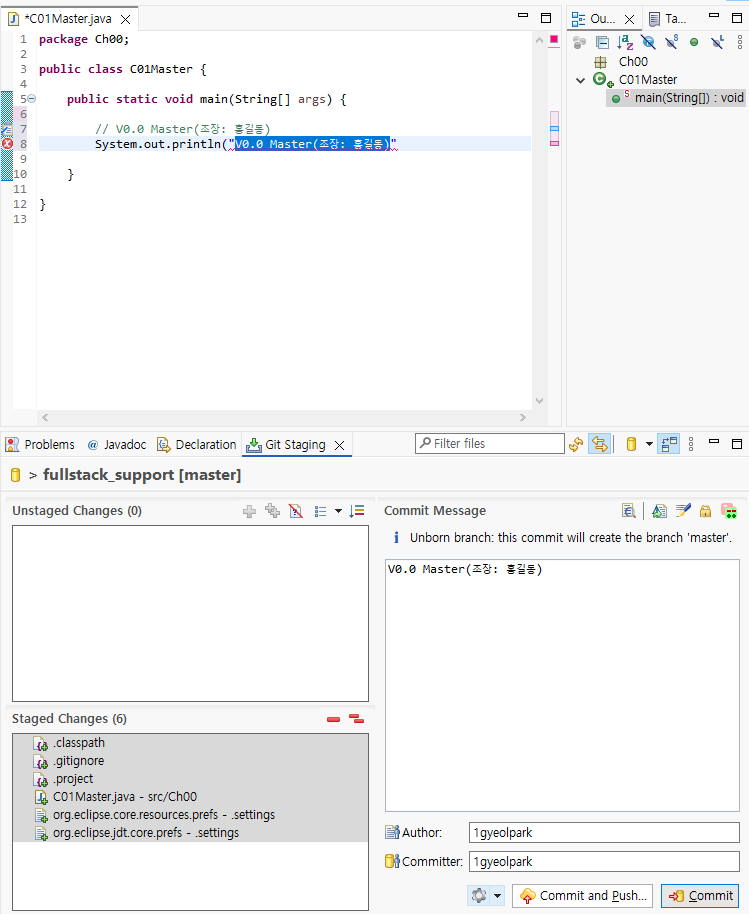

 

---

### 브랜치 만들기

> 프로젝트에서 오른쪽 마우스, `Team, Switch To, New Branch...`를 선택하고 `Source`(`master`)와 `Branch name`(`develop`)을 입력한다. `Check out new branch`를 체크하면 만든 브랜치로 바로 이동한다.

 

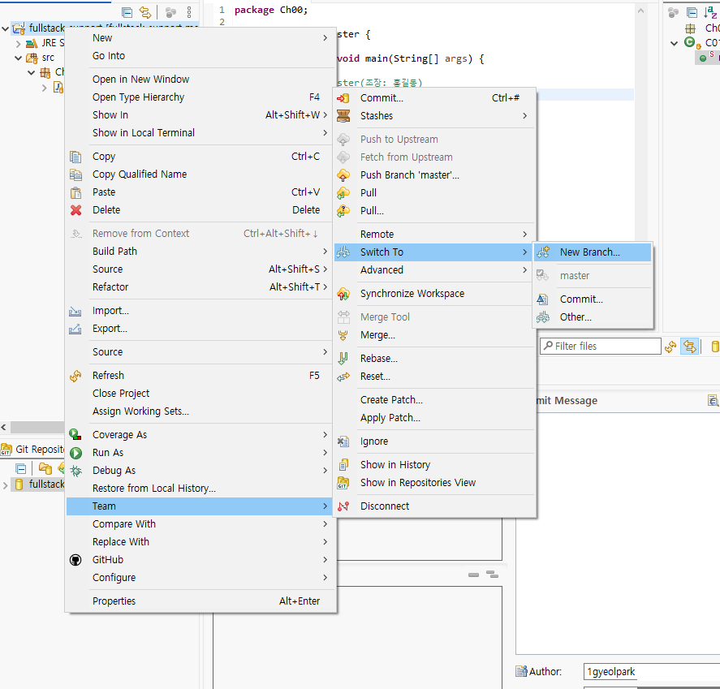

 

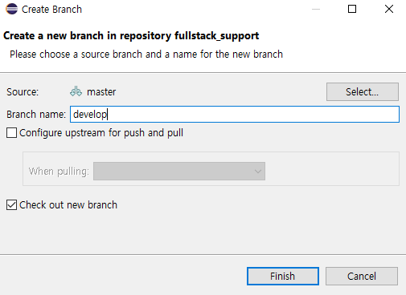

 

`develop` 브랜치에서 새 클래스(`C02Develop`)를 만들어 `System.out.println("V0.1 Develop(조장: 홍길동)");`를 작성하고 `V0.1 Develop`으로 커밋한다.

 

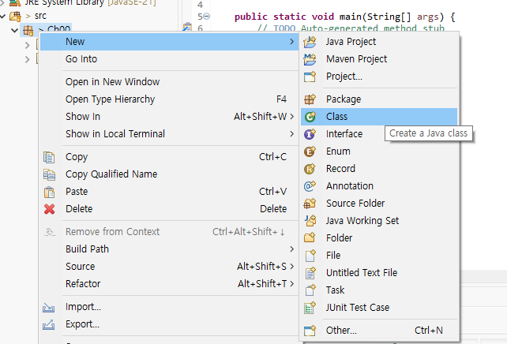

 

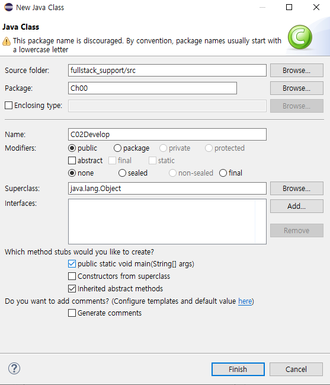

 

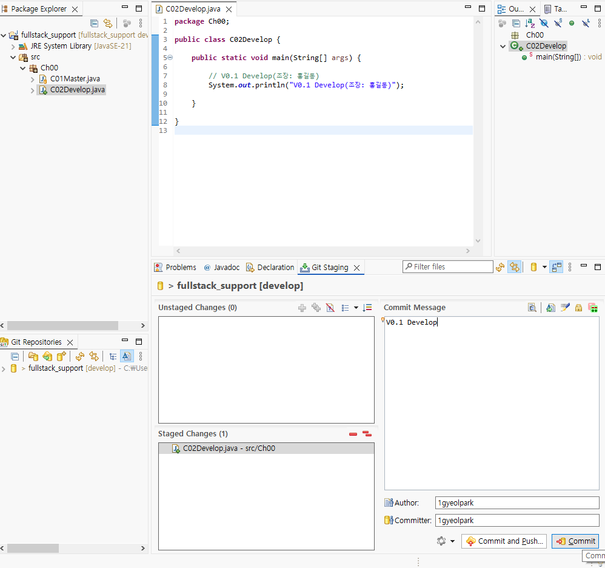

 

---

### 브랜치 병합

> `master`로 이동(`Team, Switch To, master`)한 뒤 `Team, Merge...`를 선택해 합칠 브랜치(`develop`)를 고른다. `Merge options`는 `Commit`(병합 결과를 커밋), `No commit`, `Squash` 중에서, `Fast forward options`는 `If a fast-forward, create a merge commit`을 선택했다. 결과가 `Already-up-to-date`이면 이미 반영된 상태다.

 

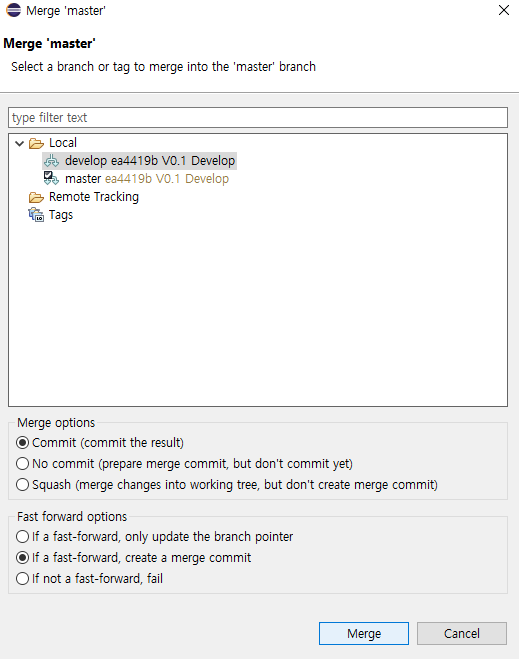

 

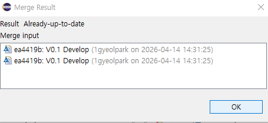

 

병합 이력은 `Team, Show in History`(`History` 뷰)에서 확인한다.

 

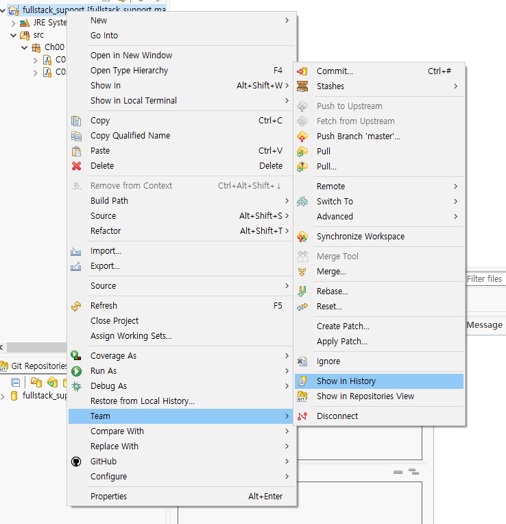

 

---

### GitHub 원격 저장소 연결

> README 없이 만든 GitHub 저장소를 `Git Repositories` 뷰의 `Remotes`에서 `Create Remote...`로 연결한다. 이름은 `origin`으로 하고 `Configure push`를 선택한 뒤 `Create`를 누른다.

 

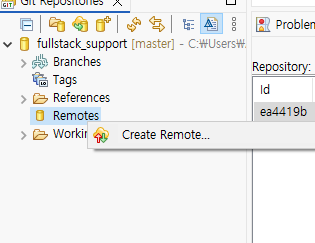

 

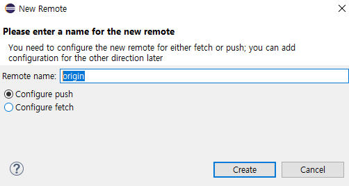

 

`Configure push for remote 'origin'` 창에서 `Change...`를 눌러 저장소 주소(`https://github.com/계정/저장소.git`)를 입력한다. `Host`, `Repository path`, `Protocol(https)`는 주소를 입력하면 채워지고 `Authentication`에는 `User`와 `Password`를 입력한 뒤 `Store in Secure Store`를 체크하면 다음부터 입력하지 않아도 된다.

 

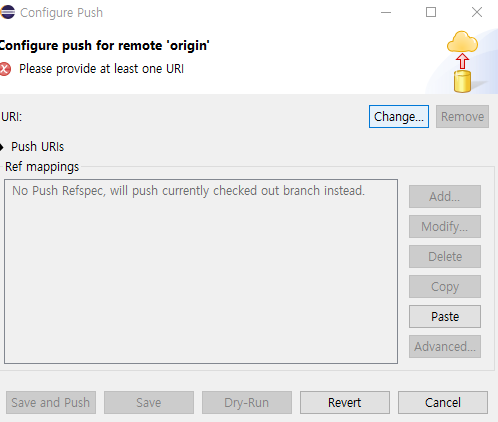

 

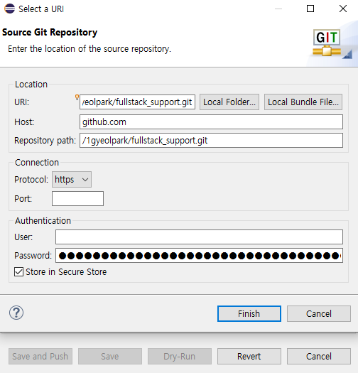

 

GitHub는 계정 비밀번호 대신 발급받은 토큰(Personal Access Token)을 `Password`에 입력한다. 토큰은 문서나 저장소에 남기지 않는다.

 

URI가 설정되면 `Save and Push`로 올린다. 커밋 창에서는 `Author`와 `Committer`에 사용자 정보가 표시된다.

 

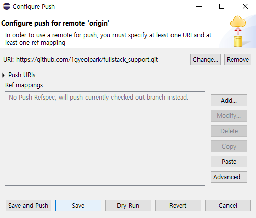

 

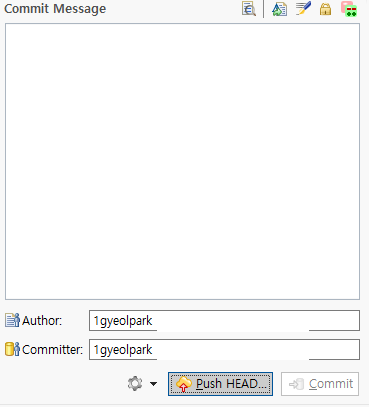

 

`Push Branch master` 창에서 `Remote`는 `origin`, `Branch`는 `master`로 두고 `Configure upstream for push and pull`을 체크한 뒤 `Push`를 누른다. 결과 창에 `master -> master [new branch]`가 나오면 성공이다. 브랜치별로 따로 푸시해야 한다.

 

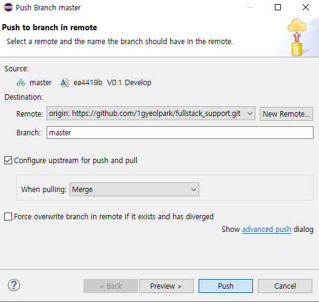

 

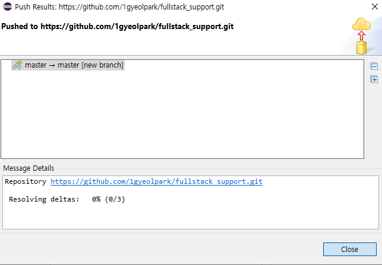

 

---

### 프로젝트 가져오기

> 이미 있는 프로젝트는 `File, Import...`에서 `General, Existing Projects into Workspace`를 선택하고 `Select root directory`로 프로젝트가 있는 폴더를 지정하면 `Projects` 목록에 나타난다. 체크하고 `Finish`를 누르면 열린다.

 

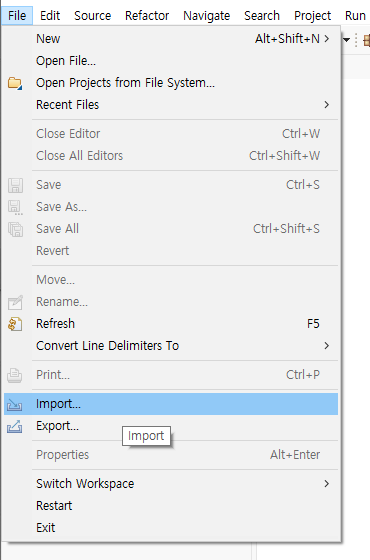

 

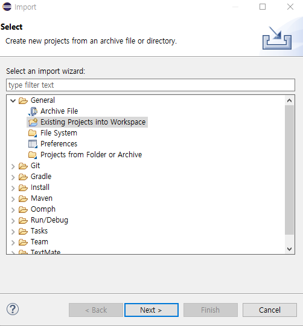

 

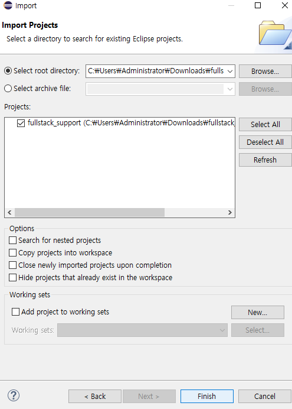

 

---

### 충돌 해결

> 같은 파일의 같은 부분을 두 브랜치에서 다르게 고치고 병합하면 충돌(Conflict)이 난다. 예제는 `develop`과 `master`에서 `C01Master.java`에 서로 다른 출력문(`V0.2 develop`, `V0.2 Master`)을 추가하고 커밋한 뒤 `master`에서 병합했다. 병합할 대상을 먼저 선택한 상태에서 실행해야 한다.

 

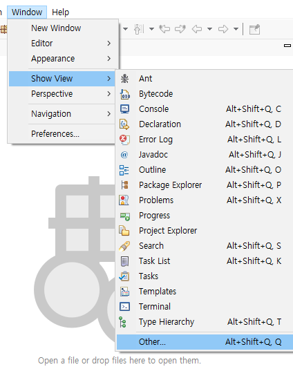

 

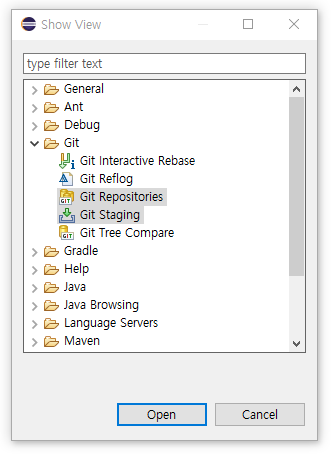

 

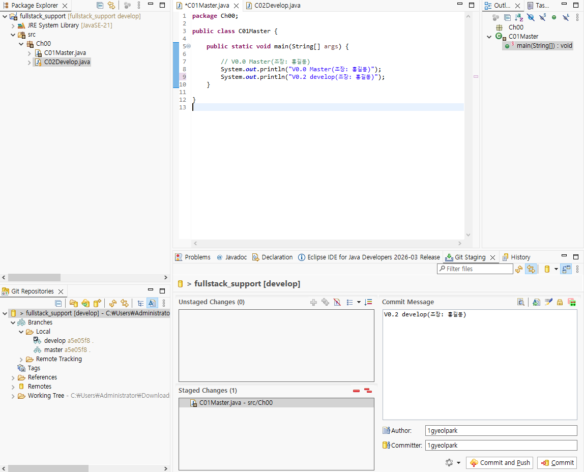

 

병합 결과가 `Conflicting`으로 나오면 충돌한 파일을 직접 고쳐야 한다.

 

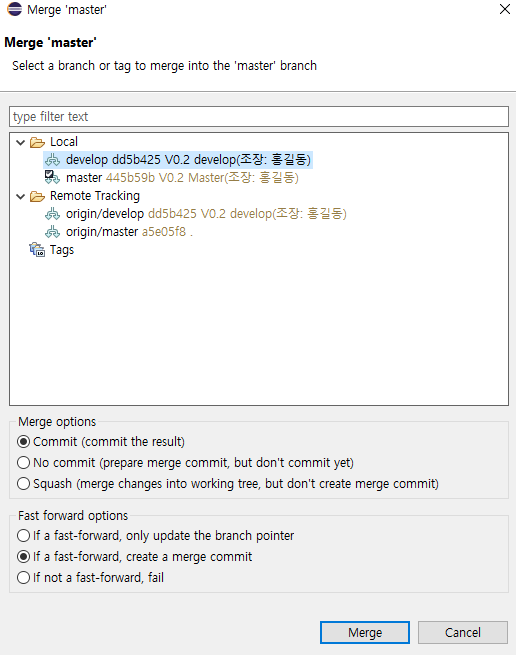

 

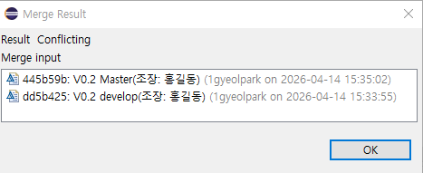

 

충돌한 파일에는 충돌 표시가 들어간다.

| **표시** | **의미** |
| --- | --- |
| `<<<<<<< HEAD` | 현재 브랜치(`master`)의 내용 시작 |
| `=======` | 두 내용의 구분 |
| `>>>>>>> refs/heads/develop` | 병합하려는 브랜치(`develop`)의 내용 끝 |

 

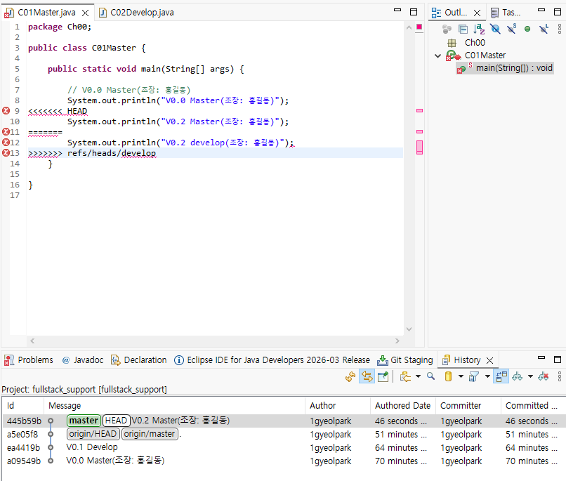

 

표시를 지우고 남길 내용만 정리해 저장한 뒤 `Git Staging`에서 파일을 Staged로 올리고 커밋한다. 커밋 메시지에는 `Merge branch 'develop'`과 충돌한 파일 목록(`Conflicts: src/Ch00/C01Master.java`)이 자동으로 들어간다. `History`에서 병합 커밋이 `develop`, `master`, `HEAD`로 표시되는 것을 확인한다.

 

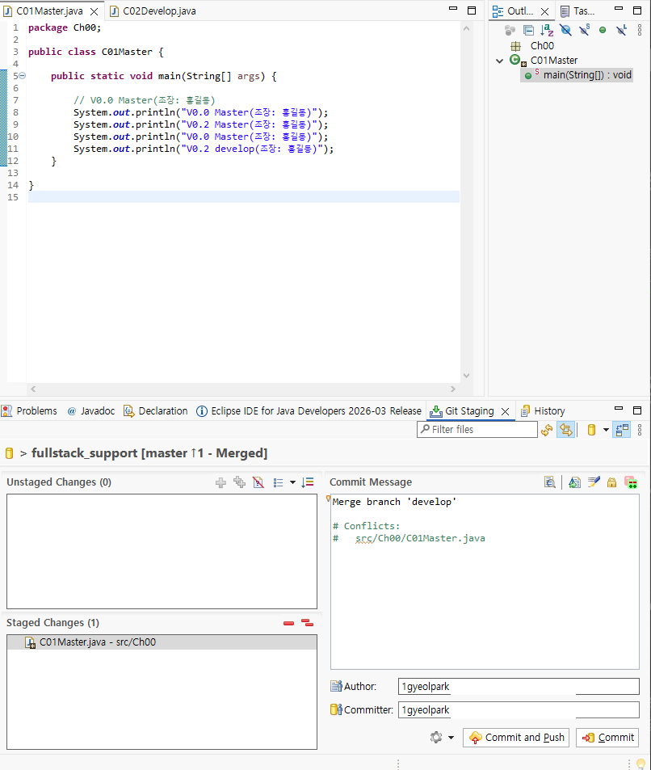

 

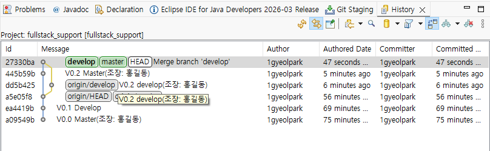

 

수정한 작업본은 `Push HEAD...`로 올린다. 브랜치별로 따로 푸시해야 한다.

 

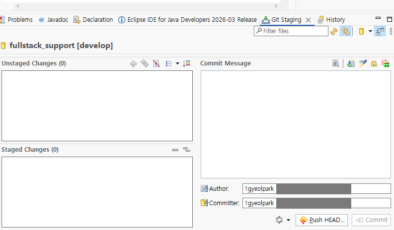

 

---

### 협업 연습

> 다른 사람의 GitHub 저장소를 `clone`해 Eclipse에서 열어 함께 작업한다. 원격 브랜치를 로컬로 받고 본인 브랜치를 만들어 작업한 뒤, GitHub에서 이슈를 열어 브랜치를 연결하고 푸시한다. 이슈를 닫고 풀리퀘스트(Pull Request)를 올려 확인받은 뒤 병합한다.

 

| **순서** | **설명** |
| --- | --- |
| 1 | 협업용 워크스페이스 폴더(`TEAM_GITHUBREPO`)를 정해 Eclipse를 실행(`Eclipse IDE Launcher`) |
| 2 | 파일을 하나 만든 저장소를 `git clone`한 뒤 `File, Import, Existing Projects into Workspace`로 열기 |
| 3 | `Git Repositories`에서 원격 브랜치(`origin/develop`)를 `Check Out as New Local Branch`로 받기 |
| 4 | 브랜치 만들기 창에서 `Source`를 `origin/develop`으로 하고 이름을 입력해 본인 브랜치(`feature/이름`) 만들기 |
| 5 | 클래스를 만들어 작업하고 `Git Staging`에서 커밋, 푸시 |
| 6 | GitHub에서 이슈를 열어 브랜치를 연결하고, 푸시한 뒤 이슈를 닫고 풀리퀘스트로 확인받아 병합 |

 

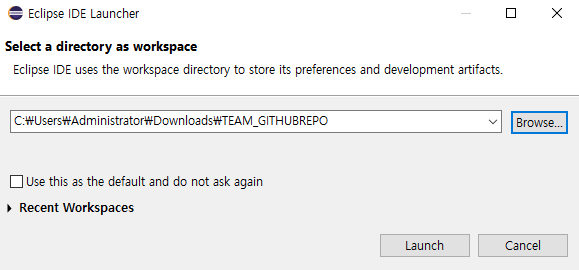

 

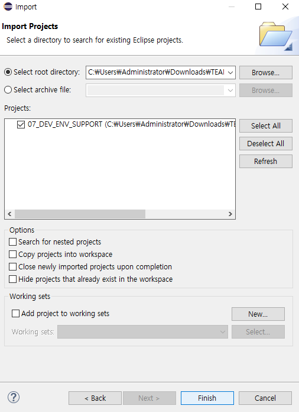

 

원격 브랜치를 선택하면 `Check out remote-tracking branch` 창이 나오는데, 작업하려면 새 로컬 브랜치를 만들어야 하므로 `Check out as New Local Branch`를 선택한다. `Check out Commit`은 그 시점의 코드를 확인만 한다.

 

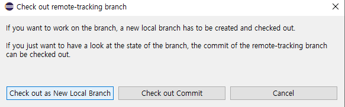

 

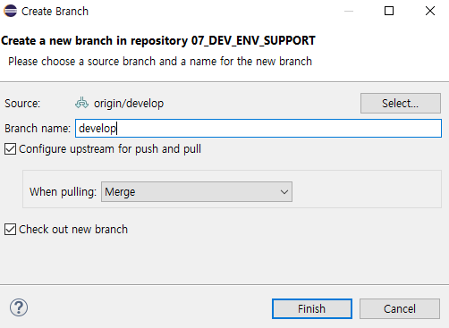

 

`Git Repositories`의 `Branches`에서 `Local`(내 브랜치와 `master`)과 `Remote Tracking`(`origin/develop`, `origin/master`, 팀원들의 `origin/feature/이름` 브랜치)을 확인할 수 있다. 본인 브랜치에서 클래스를 만들어 커밋한다.

 

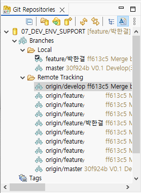

 

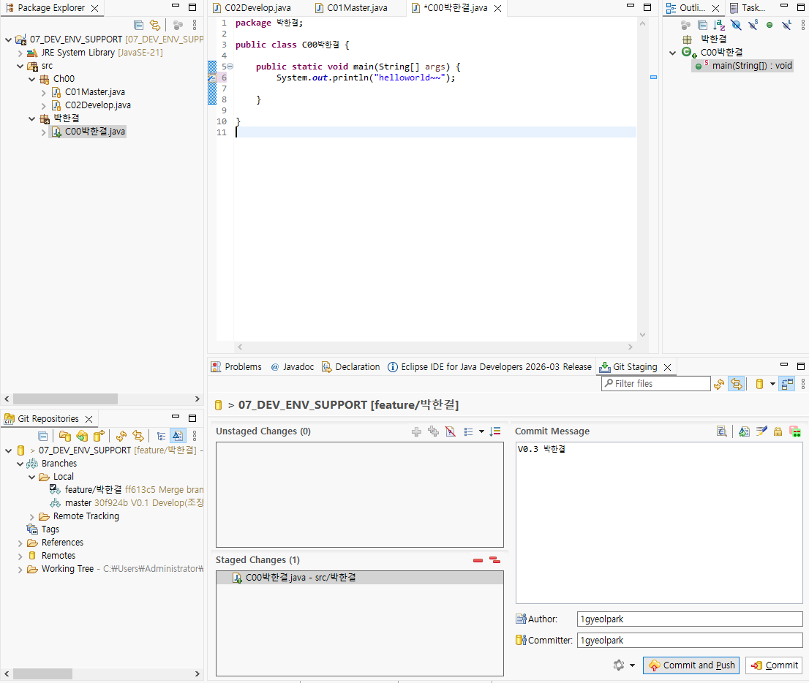

 

 

---

 

**Eclipse_Git 요약**

<aside>

> Eclipse Team 메뉴: Share Project(.git 생성), Switch To(브랜치), Merge, Show in History  
Git Repositories와 Git Staging 뷰로 변경 확인과 커밋  
원격은 Remotes, Create Remote(origin)로 연결하고 토큰으로 인증  
충돌은 표시(<<<<<<<, =======, >>>>>>>)를 직접 정리하고 커밋  
협업: clone, import, 원격 브랜치 check out, 본인 브랜치, 이슈, 풀리퀘스트

</aside>

 

### Link
[EGit 사용 설명서](https://wiki.eclipse.org/EGit/User_Guide)
